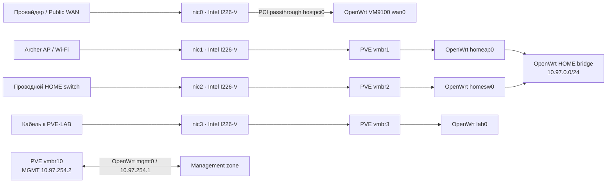
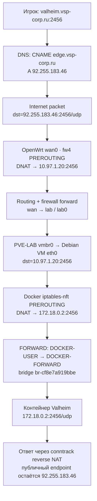
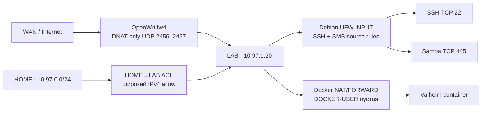
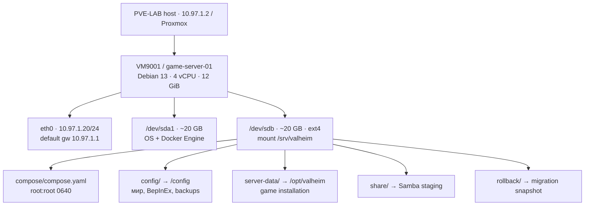
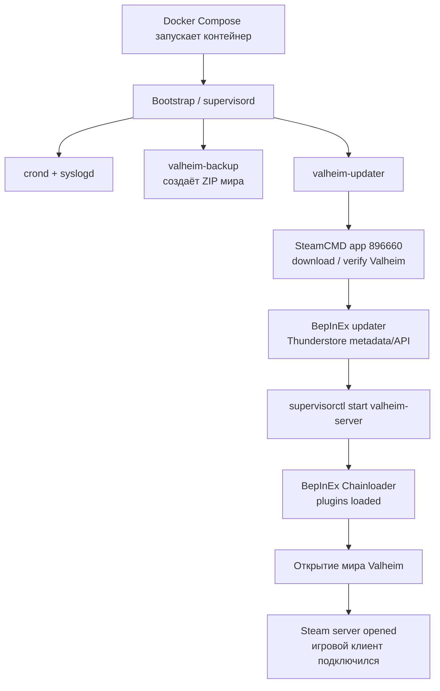
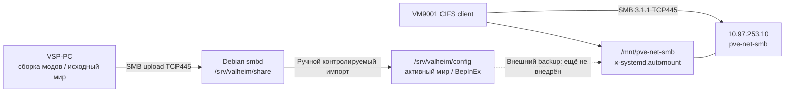
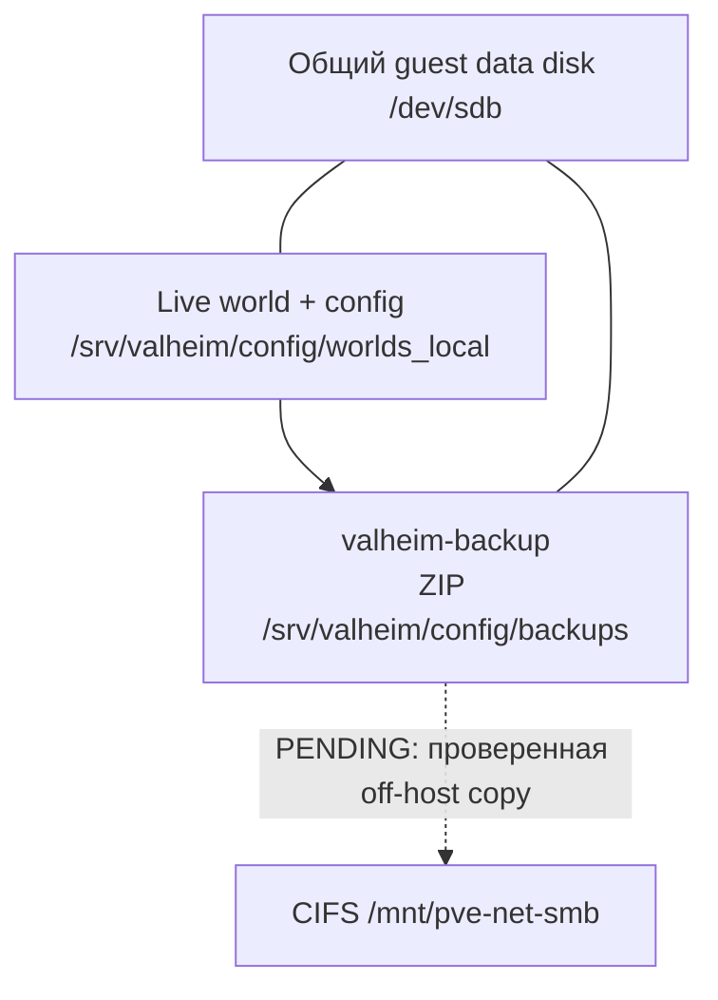

# Архитектура сервера Valheim: от железа до входа игрока

**Архитектурный разбор для выступления: физическая сеть, виртуализация, контейнер и игровой мир**  
**Основа:** технический снимок 2026-11-08 · **Аудитория:** Infrastructure Support L2 / Linux / Technical Operations / Junior DevOps  
**Формат:** путь игрока через все слои системы; схемы и таблицы сохранены.

> **С чего начать рассказ.** Игрок видит один адрес Valheim. За ним стоят два физических Proxmox-хоста: PVE-NET держит сеть и OpenWrt, PVE-LAB запускает Debian VM с игровым контейнером. Пакет проходит два DNAT, а мир и конфигурация лежат на отдельном ext4-диске. Дальше пройдём этот путь по слоям — от кабеля до состояния мира.

**Как читать статусы:** **PASS** — подтверждённый вывод или тест владельца; **DESIGN** — принятое решение без подтверждённого внедрения; **PENDING** — ещё не проверено; **[Needs confirmation]** — точное значение неизвестно. Эти метки показывают, где заканчиваются факты архитектурного снимка.

## 1. Архитектура одним взглядом: физические узлы, зоны и приложение

Начну с простой карты. Слева игрок, справа игровой мир. Между ними две физические машины с разными обязанностями. Если слушатель запомнит эту схему, остальная история сложится сама.


**Почему две машины?** PVE-NET работает постоянно: он держит маршрутизацию, правила между зонами и управление сетью. PVE-LAB включается под игровые и лабораторные задачи. Если выключить LAB, Valheim пропадёт, но домашняя сеть по архитектуре должна продолжить работать. Отдельный полный тест «LAB выключен, все остальные контуры проверены» пока не зафиксирован.

| Физическая машина | Реальная роль | Последняя подтверждённая конфигурация |
|---|---|---|
| **PVE-NET** | Основной сетевой гипервизор | Firebat Intel N100, 8 GiB RAM, 4 × Intel I226-V; Proxmox VE 9.2.x; `pve-net`, MGMT `10.97.254.2/24` |
| **PVE-LAB** | Вычислительный хост игровых/лабораторных VM | ASRock B450M-HDV R4.0, AMD Ryzen 5 1600 6C/12T, 32 GiB RAM, 2 × Realtek GbE; `pve-lab`, `10.97.1.2/24` |
| **VM9100** | OpenWrt v2.0 на PVE-NET | `wan0`, `lab0`, `fw4/nftables`; рабочий WAN `92.255.183.46/23` |
| **VM9001** | Debian 13 game-server на PVE-LAB | 4 vCPU, 12 GiB; `10.97.1.20/24`, gateway `10.97.1.1`; Docker + Valheim |

Точки источников: [PVE-LAB Stage001](https://github.com/ValentS1997/pve-lab-vsp/blob/main/stages/001.Stage-Baseline/BASELINE-EVIDENCE-2026-10-28.md), [PVE-LAB Stage002](https://github.com/ValentS1997/pve-lab-vsp/blob/main/stages/002.Stage-PVE-Core/PVE-CORE-EVIDENCE-2026-10-29.md), [PrOWRT PVE-NET rename/port mapping](https://github.com/ValentS1997/PrOWRT/blob/main/docs/STAGE002-PVE-NET-RENAME-ACCEPTANCE-2026-10-29.md).

## 2. PVE-NET: четыре порта, PCI passthrough, VM bridge и сетевые зоны

На сетевой машине важно не количество портов само по себе, а то, кому принадлежит каждый путь. Один порт смотрит к провайдеру, два ведут домой, ещё один — в лабораторный хост.



**Что делает каждый слой.** Linux bridge соединяет интерфейсы внутри одного L2-сегмента, как виртуальный коммутатор. OpenWrt маршрутизирует между подсетями и применяет правила `fw4`. Публичный WAN-порт отдан виртуальной машине OpenWrt через PCI passthrough, поэтому нельзя автоматически приписывать WAN-адрес самому Proxmox. Для управления PVE-NET есть отдельные MGMT и USB OOB пути.

**Сегменты/подсети** (не называть их все «VLAN» без вывода `ip -d link`/802.1Q):

| Зона | Подсеть | Назначение | Примечание |
|---|---|---|---|
| HOME | `10.97.0.0/24` | Игровой ПК, проводные/Wi-Fi устройства | Archer и switch разделены физически, HOME — общий L2-сегмент |
| LAB | `10.97.1.0/24` | PVE-LAB и VM9001 | OpenWrt gateway `10.97.1.1` |
| SERVICES | `10.97.253.0/24` | Внутренние службы, SMB | CIFS target `10.97.253.10` |
| MGMT | `10.97.254.0/24` | Управление Proxmox/OpenWrt | `pve-net 10.97.254.2`, OpenWrt `10.97.254.1` |
| Admin VPN | `10.97.252.0/24` | План/сегмент admin VPN | Текущая operational acceptance VPN [Needs confirmation] |
| DMZ | `10.97.30.0/24` | Сегмент отдельных публичных сервисов | Не используется в текущем игровом маршруте |
| Physical OOB | `10.97.255.0/30` | Прямой USB-Ethernet PC → PVE-NET | `10.97.255.2` ↔ `10.97.255.1`, не routed gateway |

Здесь у меня есть снимок конфигурации PVE-NET от 29 октября: `net0/vmbr10/mgmt0`, `net1/vmbr1/homeap0`, `net2/vmbr2/homesw0`, `net3/vmbr3/lab0`, `hostpci0/wan0`. На PVE-LAB зафиксирован `vmbr0=10.97.1.2/24` на `nic1`. А вот точную строку `net0` у VM9001 ещё нужно получить: **[Needs confirmation]**, команда на PVE-LAB — `qm config 9001`.

## 3. Полный путь игрового UDP-пакета: две NAT-трансляции

Теперь проследим один пакет так, как будто мы идём рядом с ним. Игрок набирает имя сервера, DNS находит публичный адрес, а дальше адрес назначения меняется два раза.



| Хоп | Адрес назначения до | Адрес назначения после | Где выполняется | Что проверено |
|---|---|---|---|---|
| Public DNS | `valheim.vsp-corp.ru` | `92.255.183.46` | DNS CNAME/A | Public resolver `1.1.1.1` PASS 2026-11-01 |
| Edge DNAT | `92.255.183.46:2456/udp` | `10.97.1.20:2456/udp` | OpenWrt `fw4` / `nft` | UCI, runtime nft, DNAT counters 0→2 packets/593 bytes |
| LAB routing | `10.97.1.20` | адрес не меняется | OpenWrt `lab0` → PVE-LAB | Внешнее подключение подтвердило end-to-end путь |
| Docker DNAT | `10.97.1.20:2456/udp` | `172.18.0.2:2456/udp` | Debian `iptables-nft` | NAT rule для 2456/2457 отображён |
| Application | `172.18.0.2:2456` | Valheim process | Внутри контейнера | Успешная игровая сессия 2026-11-01 |
| Обратный путь | Ответ контейнера | Reply к внешнему клиенту | Conntrack/NAT | Подтверждено функционально, отдельный packet trace не проводили |

Для UDP 2457 путь такой же. Важно не перепутать объявленный контейнером порт и опубликованный на хосте: 2458 есть в `EXPOSE` образа, но через Docker на Debian он **не публиковался**. TCP 80/9001 тоже оставались только `EXPOSE`, без host binding.

**Как приходит ответ.** У UDP нет TCP three-way handshake, но conntrack запоминает поток и выполняет обратное преобразование NAT. Счётчик `nft` показывает, что пакеты прошли правило; он ещё не доказывает, что человек вошёл в игру. Поэтому 1 ноября я проверил именно внешний игровой вход. Отдельную трассировку ответного пакета не проводили.

## 4. Межзональные политики и три точки фильтрации

Здесь легко сказать «у меня есть firewall» и пропустить главное. Фильтрация происходит на разных участках пути, и правило на Debian не обязательно управляет трафиком, который Docker уже отправил в контейнер.



**На внешней границе** OpenWrt направляет только UDP 2456–2457 из `wan` в `lab`: правило `firewall.prowrt_valheim_wan` / `Valheim-WAN-UDP`, `nat_reflection=false`. WAN имел публичный `92.255.183.46/23`, gateway `92.255.183.254`; CGNAT на интерфейсе не обнаружен. Из HOME игру разумнее проверять напрямую по `10.97.1.20:2456`: отражение NAT выключено.

**На самой Debian VM** UFW `0.36.2-9` был `active`, с `deny incoming / allow outgoing / deny routed` и low logging. SSH TCP 22 разрешён от `10.97.0.10` и `10.97.1.0/24`; SMB TCP 445 — от HOME `/24` и LAB `/24`. Это правила для самого хоста; опубликованные Docker порты проходят через другой путь.

**На пути к контейнеру** Docker использует `iptables v1.8.11 (nf_tables)`: FORWARD проходит через `DOCKER-USER`, затем `DOCKER-FORWARD`. `DOCKER-USER` была пустой. Опубликованный Docker порт идёт через DNAT/FORWARD, а не через обычную UFW INPUT policy для самого хоста. Поэтому наличие UFW нельзя выдавать за доказательство фильтрации контейнера; Docker-managed nftables rules вручную не правят.

**Граница политики.** `firewall.prowrt_home_to_lab_initial` разрешает весь IPv4 HOME→LAB; LAB→SERVICES TCP445 разрешён для `10.97.1.0/24`. Это фактические границы доступа на снимке, а не утверждение, что разрешён только трафик одной VM.

## 5. VM9001: Debian, виртуальные диски, Docker и управление доступом

Когда пакет добрался до LAB, он попадает в обычную Debian VM. Её удобно представлять как три части: система, данные мира и способ запустить контейнер.



**Что внутри VM.** Debian 13 Trixie, пользователь `vspadmin`; зафиксированы Docker Engine 29.9.2, Compose v5.6.1 и образ `ghcr.io/community-valheim-tools/valheim-server:1.4.0`. ОС и данные мира логически лежат на разных виртуальных дисках. Физический backend на PVE-LAB ещё **[Needs confirmation]**: второй `/dev/sdb` внутри VM сам по себе не означает второй независимый диск.

Данные мира смонтированы из `/dev/sdb` в `/srv/valheim` как ext4 `rw`. Каталог Compose принадлежит `root:root`: `/srv/valheim/compose` имеет `drwxr-x---`, `compose.yaml` — `-rw-r-----`. Секрет пароля передаётся контейнеру как файл только для чтения.

| Роль | Путь или параметр |
|---|---|
| Основной Compose | `/srv/valheim/compose/compose.yaml` |
| Password secret | `/srv/valheim/compose/secrets/server_pass` → `/run/secrets/server_pass` (`ro`) |
| Game world | `/srv/valheim/config/worlds_local/Valheim/` |
| BepInEx plugins | `/srv/valheim/config/bepinex/plugins/` |
| Config/JSON/YAML | `/srv/valheim/config/bepinex/` |
| Local ZIP backups | `/srv/valheim/config/backups/` |
| Docker persisted binaries | `/srv/valheim/server-data/` |
| Local staging | `/srv/valheim/share/` |

Полного security-reviewed Compose в Git нет. Из runtime подтверждены `SERVER_NAME=VSP Valheim`, `WORLD_NAME=Valheim`, `CROSSPLAY=false`, `BEPINEX=true`, `SERVER_PASS_FILE=/run/secrets/server_pass` и публикация двух UDP-портов. `SERVER_PUBLIC`, restart policy, `UPDATE_CRON` и фактический image digest пока **[Needs confirmation]**.

## 6. Как контейнер открывает игровой мир

Контейнер — не один процесс. Supervisor запускает вспомогательные службы, SteamCMD готовит игру, BepInEx загружает моды, а игровой процесс открывает мир и сетевой endpoint.



Внутри контейнера работают `valheim-server`, `valheim-updater`, `valheim-backup`, `crond`, `syslogd` и `valheim-bootstrap` под supervisor. BepInEx загружает плагины перед открытием мира. В исходном наборе было 43 DLL; это число файлов, включая библиотеки, а не число загруженных плагинов.


## 7. Моды, игровой мир и путь игровой сессии

После сетевой и системной части наконец появляется то, ради чего всё затевалось: игрок входит в мир, сервер обрабатывает действия через моды и сохраняет состояние.

```mermaid
sequenceDiagram
    participant Player as Игровой клиент
    participant Edge as OpenWrt / NAT
    participant Host as Debian / Docker NAT
    participant Server as Valheim Steam server
    participant Mods as BepInEx plugins
    participant World as World storage
    Player->>Edge: DNS resolved; UDP на 92.255.183.46:2456
    Edge->>Host: DNAT → 10.97.1.20:2456
    Host->>Server: DNAT → 172.18.0.2:2456
    Server-->>Player: Steam/game protocol; запрос пароля
    Player->>Server: Аутентификация / игровые действия
    Server->>Mods: Игровые events и hooks
    Mods-->>Server: Модовая логика и данные
    Server->>World: Запись chunk-based сохранения
    World-->>Server: Состояние мира
    Server-->>Player: Синхронизация игрового состояния
```

**Где живёт мир.** Путь — `/srv/valheim/config/worlds_local/Valheim/`; формат Valheim 1.0 chunk-based использует `_main.<revision>.db2`, `_main.<revision>.fwl2`, `_main.<revision>.chunks`, `_main.<revision>.ok` и `*.chunk`. Номер в имени — ревизия сохранения, не версия игры.

**Что с модами.** В наборе есть Jötunn, Epic Loot, Star Level System, MonsterLabZ, AICompanion, AutomaticFuel, AzuCraftyBoxes, XPortal и другие. На сервере используются DLL и CFG в каталоге BepInEx. Набор разделён на библиотеки, контент, gameplay, QoL, automation и object-моды.

## 8. Samba staging и CIFS mount: два разных назначения SMB

Для обмена файлами здесь два направления SMB. Одно доставляет подготовленные файлы с ПК на сервер. Другое связывает сервер с сетевым хранилищем. Путать эти роли опасно, особенно когда речь о живом мире.



**Первое направление — файлы с ПК на VM.** `smbd` отдаёт `/srv/valheim/share` через `\\10.97.1.20\valheim-share`: пользователь `vspadmin`, `force user=vspadmin`, `read only=no`, masks 0600/0700, `follow symlinks=no`. Это площадка для загрузки и проверки файлов, а не место для прямого редактирования активного мира с ПК.

**Второе направление — VM к сетевой службе.** `//10.97.253.10/pve-net-smb` монтируется в `/mnt/pve-net-smb`; credentials лежат в `/etc/samba/credentials/pve-net-smb` с `0600 root-only`. В fstab используются `_netdev,nofail,x-systemd.automount`, `uid=1000,gid=1000`, file_mode 0600 / dir_mode 0700, `WORKGROUP`. Согласован SMB 3.1.1; read/write/delete и automount после reboot — **PASS**.


## 9. Где хранятся данные и резервные копии

Последняя часть архитектуры — путь данных. Игровой мир и локальные ZIP находятся на одном гостевом диске. Сетевой CIFS путь есть, но автоматическая off-host копия на этом снимке ещё не реализована.



**Текущее размещение.** `valheim-backup` создаёт локальные ZIP в `/srv/valheim/config/backups/`. CIFS смонтирован в `/mnt/pve-net-smb`, но автоматическое копирование ZIP на другой хост ещё не внедрено.

**Граница отказа.** Мир и локальный ZIP лежат на одном гостевом диске и поэтому разделяют логический failure domain. Отдельный виртуальный data disk не доказывает независимость физического хранилища. Сетевая копия показана на схеме как планируемый путь.

## 10. Источники архитектурного снимка

Здесь можно сверить физическую схему, сетевые решения и конфигурацию Valheim.

- [PVE-LAB Stage001 — физический baseline, диски, сеть](https://github.com/ValentS1997/pve-lab-vsp/blob/main/stages/001.Stage-Baseline/BASELINE-EVIDENCE-2026-10-28.md).
- [PVE-LAB Stage002 — SSH, PVE RBAC, UEFI recovery](https://github.com/ValentS1997/pve-lab-vsp/blob/main/stages/002.Stage-PVE-Core/PVE-CORE-EVIDENCE-2026-10-29.md).
- [PVE-LAB Stage003 — storage role design (не runtime implementation)](https://github.com/ValentS1997/pve-lab-vsp/blob/main/stages/003.Stage-Storage-Backup/STORAGE-LAYOUT-DESIGN.md).
- [PrOWRT — PVE-NET rename and VM9100 NIC mappings](https://github.com/ValentS1997/PrOWRT/blob/main/docs/STAGE002-PVE-NET-RENAME-ACCEPTANCE-2026-10-29.md).
- [PrOWRT — network architecture decisions](https://github.com/ValentS1997/PrOWRT/blob/main/ARCHITECTURE-DECISIONS.md).
- [Valheim — as-built creation/migration](https://github.com/ValentS1997/vsp-gamer-mods/blob/main/Valheim/Valheim%20Dedicated%20Server/AS_BUILT_2026-11-01.md).
- [Valheim — operations and acceptance](https://github.com/ValentS1997/vsp-gamer-mods/blob/main/Valheim/Valheim%20Dedicated%20Server/OPERATIONS_AND_ACCEPTANCE_2026-11-01.md).
- [Valheim — administrator guide](https://github.com/ValentS1997/vsp-gamer-mods/blob/main/Valheim/Valheim%20Dedicated%20Server/ADMIN_GUIDE.md).
- [Upstream Docker image — update, backup, Supervisor, BepInEx](https://github.com/community-valheim-tools/valheim-server-docker).
