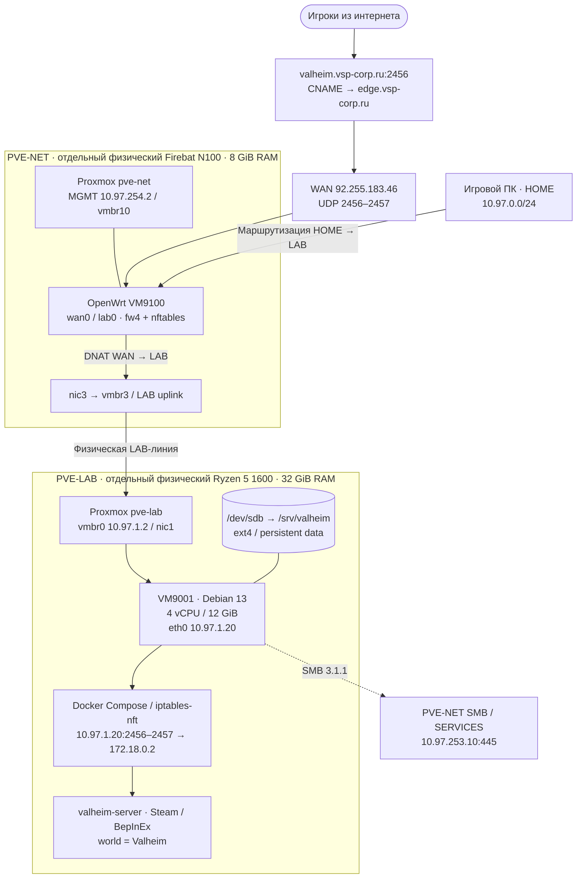
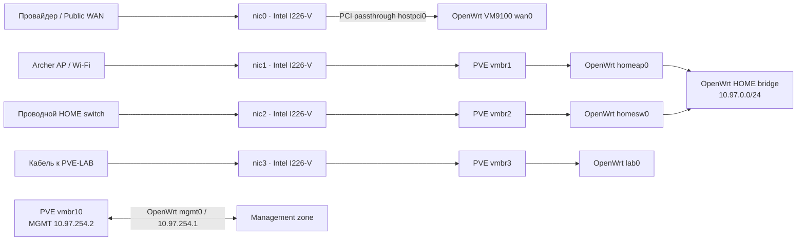
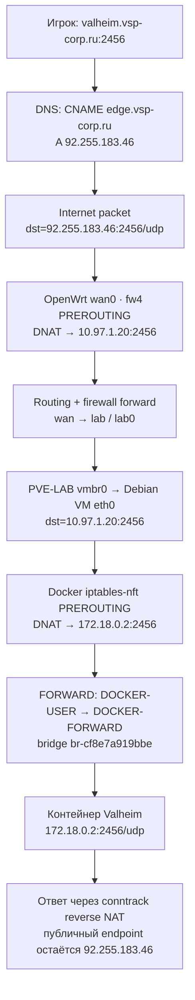
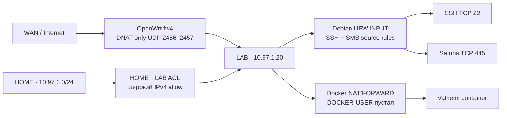
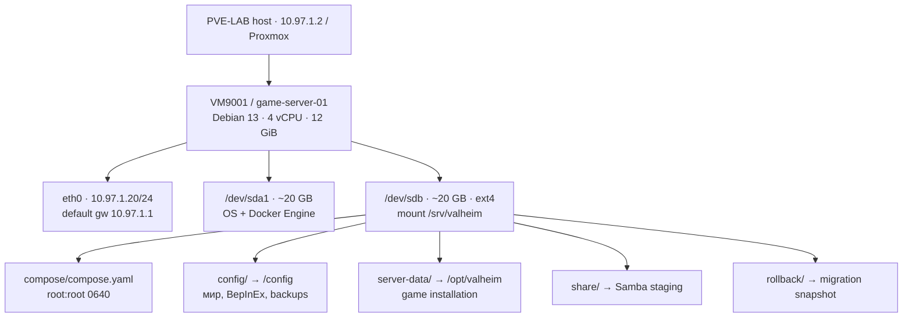
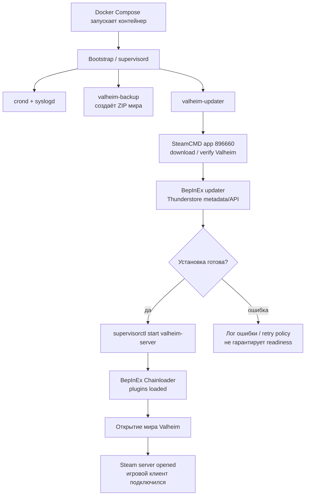
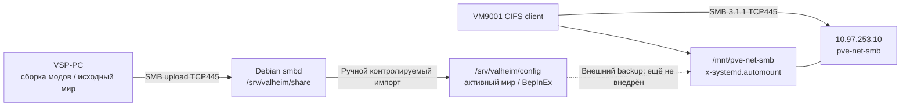
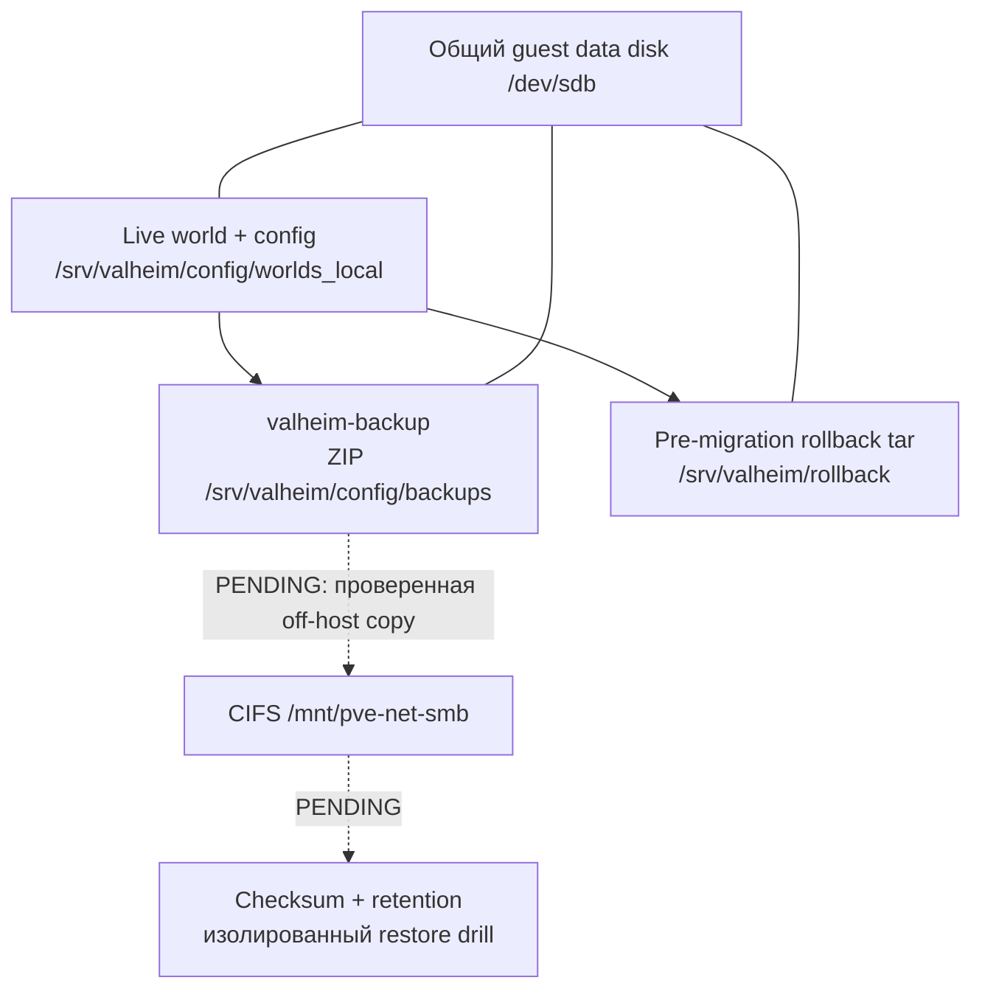
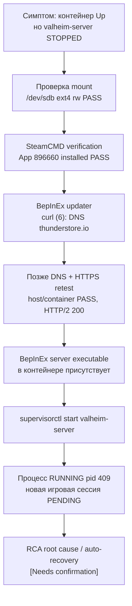

# VSP Infrastructure → Valheim Dedicated Server

**Инженерный архитектурный разбор: от физического Proxmox до игровой сессии**  
**Снимок:** 2026-11-08 · **Версия:** 1.0 · **Аудитория:** Infrastructure Support L2 / Linux / Technical Operations / Junior DevOps  
**Режим:** as-built + операционная история; это **не** подтверждение production-grade HA/DR.

> **Главная идея:** игровой сервер — отдельная Debian VM на физическом PVE-LAB, а публичный интернет-доступ проходит через OpenWrt VM на **другом** физическом Proxmox-хосте PVE-NET. Две последовательные DNAT-трансляции доставляют UDP к контейнеру. Игровые сохранения вынесены из контейнера на persistent ext4-диск. Последний успешный внешний игровой тест подтверждён владельцем 2026-11-01; после восстановления процесса 2026-11-02 новое подтверждение входа в игру отсутствует.

**Легенда доказательств:** **PASS** — подтверждено предоставленным выводом или owner test; **DESIGN** — утверждённое решение без доказанной реализации; **PENDING** — тест или внедрение не завершены; **[Needs confirmation]** — нет точного значения. Примеры команд только для чтения отмечены отдельно. Конфигурации и секреты не публикуются.

## 1. Архитектура одним взглядом: физические узлы, зоны и приложение



**Зачем два гипервизора.** PVE-NET предназначен для постоянно работающего edge-сервиса: маршрутизации, межзонального firewall и инфраструктурного управления. PVE-LAB — отдельный on-demand host для игровых и лабораторных нагрузок. Когда PVE-LAB отключён, Valheim недоступен; при этом домашняя сеть архитектурно не должна зависеть от его питания. Полный эксперимент «LAB OFF, все production-контуры PASS» отдельно не зарегистрирован.

| Физическая машина | Реальная роль | Последняя подтверждённая конфигурация |
|---|---|---|
| **PVE-NET** | Основной сетевой гипервизор | Firebat Intel N100, 8 GiB RAM, 4 × Intel I226-V; Proxmox VE 9.2.x; `pve-net`, MGMT `10.97.254.2/24` |
| **PVE-LAB** | Вычислительный хост игровых/лабораторных VM | ASRock B450M-HDV R4.0, AMD Ryzen 5 1600 6C/12T, 32 GiB RAM, 2 × Realtek GbE; `pve-lab`, `10.97.1.2/24` |
| **VM9100** | OpenWrt v2.0 на PVE-NET | `wan0`, `lab0`, `fw4/nftables`; рабочий WAN `92.255.183.46/23` |
| **VM9001** | Debian 13 game-server на PVE-LAB | 4 vCPU, 12 GiB; `10.97.1.20/24`, gateway `10.97.1.1`; Docker + Valheim |

Точки источников: [PVE-LAB Stage001](https://github.com/ValentS1997/pve-lab-vsp/blob/main/stages/001.Stage-Baseline/BASELINE-EVIDENCE-2026-10-28.md), [PVE-LAB Stage002](https://github.com/ValentS1997/pve-lab-vsp/blob/main/stages/002.Stage-PVE-Core/PVE-CORE-EVIDENCE-2026-10-29.md), [PrOWRT PVE-NET rename/port mapping](https://github.com/ValentS1997/PrOWRT/blob/main/docs/STAGE002-PVE-NET-RENAME-ACCEPTANCE-2026-10-29.md).

## 2. PVE-NET: четыре порта, PCI passthrough, VM bridge и сетевые зоны



**Разница технологий:** Linux bridge обслуживает L2-коммутацию между интерфейсами одного сегмента; OpenWrt выполняет L3-маршрутизацию между подсетями и применяет межзональные правила `fw4`. PCI passthrough отдаёт физический WAN-интерфейс гостю OpenWrt; нельзя без проверки считать, что Proxmox host владеет адресом WAN. PVE-NET MGMT и USB OOB независимы от WAN.

**Сегменты/подсети** (не называть их все «VLAN» без вывода `ip -d link`/802.1Q):

| Зона | Подсеть | Назначение | Примечание |
|---|---|---|---|
| HOME | `10.97.0.0/24` | Игровой ПК, проводные/Wi-Fi устройства | Archer и switch разделены физически, HOME — общий L2-сегмент |
| LAB | `10.97.1.0/24` | PVE-LAB и VM9001 | OpenWrt gateway `10.97.1.1` |
| SERVICES | `10.97.253.0/24` | Внутренние службы, SMB | CIFS target `10.97.253.10` |
| MGMT | `10.97.254.0/24` | Управление Proxmox/OpenWrt | `pve-net 10.97.254.2`, OpenWrt `10.97.254.1` |
| Admin VPN | `10.97.252.0/24` | План/сегмент admin VPN | Текущая operational acceptance VPN [Needs confirmation] |
| DMZ | `10.97.30.0/24` | Сегмент отдельных публичных сервисов | Не используется в текущем игровом маршруте |
| Physical OOB | `10.97.255.0/30` | Прямой USB-Ethernet PC → PVE-NET | `10.97.255.2` ↔ `10.97.255.1`, не routed gateway |

Проверенный снимок PVE-NET от 29 октября фиксирует OpenWrt VM9100: `net0/vmbr10/mgmt0`, `net1/vmbr1/homeap0`, `net2/vmbr2/homesw0`, `net3/vmbr3/lab0`, `hostpci0/wan0`. Для управления PVE-LAB физический хост имел `vmbr0=10.97.1.2/24` на `nic1`, однако **точная строка `net0` для VM9001 ещё [Needs confirmation]**. Проверять на PVE-LAB: `qm config 9001`.

## 3. Полный путь игрового UDP-пакета: две NAT-трансляции



| Хоп | Адрес назначения до | Адрес назначения после | Где выполняется | Что проверено |
|---|---|---|---|---|
| Public DNS | `valheim.vsp-corp.ru` | `92.255.183.46` | DNS CNAME/A | Public resolver `1.1.1.1` PASS 2026-11-01 |
| Edge DNAT | `92.255.183.46:2456/udp` | `10.97.1.20:2456/udp` | OpenWrt `fw4` / `nft` | UCI, runtime nft, DNAT counters 0→2 packets/593 bytes |
| LAB routing | `10.97.1.20` | адрес не меняется | OpenWrt `lab0` → PVE-LAB | Внешнее подключение подтвердило end-to-end путь |
| Docker DNAT | `10.97.1.20:2456/udp` | `172.18.0.2:2456/udp` | Debian `iptables-nft` | NAT rule для 2456/2457 отображён |
| Application | `172.18.0.2:2456` | Valheim process | Внутри контейнера | Успешная игровая сессия 2026-11-01 |
| Обратный путь | Ответ контейнера | Reply к внешнему клиенту | Conntrack/NAT | Подтверждено функционально, отдельный packet trace не проводили |

Схема для 2457 аналогична. Порт 2458, хотя присутствует как `EXPOSE` контейнерного образа, **не публиковался** через Docker на гостевом хосте. TCP 80/9001 также были только container EXPOSE, без host binding.

**Почему работает UDP:** нет TCP three-way handshake. Сетевая система отслеживает UDP flows через connection tracking; возвратный трафик преобразуется по созданным NAT mappings. Проверка `nft counter` сама по себе не доказывает игровой handshake; отдельный external game join — доказательство выше уровня пакета.

## 4. Межзональные политики и три точки фильтрации



**OpenWrt edge:** UCI rule `firewall.prowrt_valheim_wan`, `Valheim-WAN-UDP`, `wan → lab`, UDP 2456–2457, `nat_reflection=false`. Public IP WAN `92.255.183.46/23`, gateway `92.255.183.254`; CGNAT на WAN interface не обнаружен. Из HOME локальный join лучше проверять на `10.97.1.20:2456`, поскольку hairpin NAT выключен.

**Debian host UFW:** version `0.36.2-9`, `active`, defaults `deny incoming / allow outgoing / deny routed`, low logging; SSH TCP 22 от `10.97.0.10` и `10.97.1.0/24`, SMB TCP 445 от HOME `/24` и LAB `/24`. `ufw.service enabled`, `ENABLED=yes`; в исходной сессии systemd unit показывал `inactive/dead` при активном firewall — post-reboot persistence ещё PENDING.

**Docker firewall:** `iptables v1.8.11 (nf_tables)`; filter FORWARD начинается с `DOCKER-USER` и затем `DOCKER-FORWARD`. `DOCKER-USER` существовала, но была пустой. Docker DNAT пропускает опубликованные порты через FORWARD, не обычную host UFW INPUT policy. Вручную редактировать Docker-managed nftables rules нельзя.

**Security debt:** `firewall.prowrt_home_to_lab_initial` даёт весь IPv4 HOME→LAB; в отдельном SMB incident разрешение исходника LAB→SERVICES TCP445 расширено до `10.97.1.0/24` вместо одной VM. Эти политики следует сужать только после инвентаризации потребителей и отдельного change request. **Не заявлять**, что TCP22/445 из WAN уже отрицательно протестированы: статус `PENDING`.

## 5. VM9001: Debian, виртуальные диски, Docker и управление доступом



**Гостевая ОС:** Debian 13 Trixie, user `vspadmin`; зафиксированные Docker Engine 29.9.2, Compose v5.6.1, image `ghcr.io/community-valheim-tools/valheim-server:1.4.0`. Системный и дата-диски логически разделены. **Физический backend virtual disk на PVE-LAB [Needs confirmation]**: второй guest `/dev/sdb` не означает второй физический failure domain.

Подтверждение mount после reboot: `/dev/sdb` → `/srv/valheim` ext4 `rw`. Обязательный preflight **до запуска**:

```bash
findmnt /srv/valheim
sudo docker ps --format 'table {{.Names}}\t{{.Status}}\t{{.Ports}}'
sudo docker exec valheim-server supervisorctl status
```

На Debian root-only Compose directory из вывода 2 ноября: `/srv/valheim/compose` = `drwxr-x--- root:root`, `compose.yaml` = `-rw-r----- root:root`. Поэтому `vspadmin` получил `cd: Permission denied`. Это Linux DAC, не ошибка Docker; **не менять права массово**. Работать с Compose по точному пути:

```bash
sudo docker compose -f /srv/valheim/compose/compose.yaml ps
sudo docker compose -f /srv/valheim/compose/compose.yaml up -d valheim
```

Последняя команда изменяет runtime (создание/запуск контейнера); запускать только после проверки mount и в согласованное окно. Простой `docker compose up -d` из `$HOME` сообщил `no configuration file provided` — Compose не нашёл YAML.

| Роль | Путь или параметр |
|---|---|
| Основной Compose | `/srv/valheim/compose/compose.yaml` |
| Password secret | `/srv/valheim/compose/secrets/server_pass` → `/run/secrets/server_pass` (`ro`) |
| Game world | `/srv/valheim/config/worlds_local/Valheim/` |
| BepInEx plugins | `/srv/valheim/config/bepinex/plugins/` |
| Config/JSON/YAML | `/srv/valheim/config/bepinex/` |
| Local ZIP backups | `/srv/valheim/config/backups/` |
| Docker persisted binaries | `/srv/valheim/server-data/` |
| Local staging | `/srv/valheim/share/` |
| Pre-migration archive | `/srv/valheim/rollback/pre-migration-20261101-110140/pre-migration.tar.gz` |

Итоговый Compose не был выгружен целиком в Git как security-reviewed as-built artifact. Из runtime точно известны `SERVER_NAME=VSP Valheim`, `WORLD_NAME=Valheim`, `CROSSPLAY=false`, `BEPINEX=true`, `SERVER_PASS_FILE=/run/secrets/server_pass`, публикация двух UDP-портов. `SERVER_PUBLIC`, restart policy, `UPDATE_CRON`, фактический image digest **[Needs confirmation]**.

## 6. Контейнерный startup: почему «Docker Up» не равно «игра готова»



Внутри image есть не один процесс, а supervisor-managed службы: `valheim-server`, `valheim-updater`, `valheim-backup`, `crond`, `syslogd`, `valheim-bootstrap` (ожидаемо `EXITED` после bootstrap). Исходно наблюдали `40 plugins to load` → `39 loaded, 1 skipped, 0 failed` → `Opened Steam server` (2026-11-01). **43 DLL — исходный инвентарь файлов, а не 43 загруженных плагина**: есть библиотеки и один skipped.

| Проверяемый уровень | Команда | Реальный смысл |
|---|---|---|
| Docker daemon | `systemctl is-active docker` | Работает engine |
| Контейнер | `sudo docker ps` | Запущен container main process |
| Supervisor | `sudo docker exec valheim-server supervisorctl status` | Запущены нужные internal services |
| Game readiness | `sudo docker logs ...` и реальный join | BepInEx/Steam завершили startup, игра доступна |
| Persistence | `findmnt /srv/valheim` + после reboot | Данные сохранены на нужном диске |

Upstream image умеет автоматически обновлять игру/BepInEx; обычно проверяет обновления раз в 15 минут при простое, но **runtime расписание и выключение автообновлений на этой VM не проверены**. Для тестового модпака обновление должно иметь maintenance window и backup/rollback.

## 7. Моды, игровой мир и путь игровой сессии

```mermaid
sequenceDiagram
    participant Player as Игровой клиент
    participant Edge as OpenWrt / NAT
    participant Host as Debian / Docker NAT
    participant Server as Valheim Steam server
    participant Mods as BepInEx plugins
    participant World as World storage
    Player->>Edge: DNS resolved; UDP на 92.255.183.46:2456
    Edge->>Host: DNAT → 10.97.1.20:2456
    Host->>Server: DNAT → 172.18.0.2:2456
    Server-->>Player: Steam/game protocol; запрос пароля
    Player->>Server: Аутентификация / игровые действия
    Server->>Mods: Игровые events и hooks
    Mods-->>Server: Модовая логика и данные
    Server->>World: Запись chunk-based сохранения
    World-->>Server: Состояние мира
    Server-->>Player: Синхронизация игрового состояния
```

**Мир:** `/srv/valheim/config/worlds_local/Valheim/`, формат Valheim 1.0 chunk-based: `_main.<revision>.db2`, `_main.<revision>.fwl2`, `_main.<revision>.chunks`, `_main.<revision>.ok`, файлы `*.chunk`. При миграции был `revision 398`, в логе backup 2 ноября наблюдали файлы `revision 414`. Номер в имени — **ревизия сохранения, не версия игры**.

**Migration steps:** preflight mount и исходников → graceful stop → rollback archive → copy оригинального мира в live → импорт 43 DLL, 130 конфигов → `WORLD_NAME=Valheim` и secret-файл → `docker compose config -q` → `up -d` → лог BepInEx/Steam → тест игрока. Исходный мир сохранился отдельно в `/srv/valheim/share/worlds_local/Valheim`; тестовый `VSP_DS_TEST` тоже сохранён.

**Modded environment:** Jötunn, Epic Loot, Star Level System, MonsterLabZ, AICompanion, AutomaticFuel, AzuCraftyBoxes, XPortal и другие. Модовый пакет разделён по библиотекам/контенту/gameplay/QoL/automation/object. На сервер перенесена фактическая копия DLL+CFG; плановый client manifest и runtime inventory **не идентичны автоматически**. Полный audit конкретных игровых модовых объектов, сетевой синхронизации и нескольких игроков — PENDING.

## 8. Samba staging и CIFS mount: два разных назначения SMB



**SMB server на VM:** `smbd` раздаёт `/srv/valheim/share` через `\\10.97.1.20\valheim-share`, user `vspadmin`, `force user=vspadmin`, `read only=no`, file/directory masks 0600/0700, `follow symlinks=no`. Назначение — **staging**, а не live edit мира с ПК.

**SMB client на VM:** `//10.97.253.10/pve-net-smb` → `/mnt/pve-net-smb`; credentials `/etc/samba/credentials/pve-net-smb` `0600 root-only`, `WORKGROUP`; fstab использует `_netdev,nofail,x-systemd.automount`, `uid=1000,gid=1000`, file_mode 0600 / dir_mode 0700. SMB negotiated `3.1.1`, read/write/delete PASS, automount после reboot PASS.

**Значимый инцидент:** сначала `Connection refused`/CIFS `error(111)` — не проходил TCP445 через межзональную ACL; после изменения разрешения появился `STATUS_LOGON_FAILURE`/`error(13)` — транспорт заработал, но credentials-файл не проходил SMB authentication. Ручной пароль через `smbclient -U` работал, файл через `smbclient -A` — нет; authfile пересоздали и проверили **до** замены. Это разные причины, которые не надо лечить одним способом.

## 9. Резервное копирование, failure domains и restore



**PASS:** локальный worker `valheim-backup` создавал ZIP мира; в логах retention «newest 6» и «older than 3 days». До миграции создан archive `/srv/valheim/rollback/pre-migration-20261101-110140/pre-migration.tar.gz`. После reboot CIFS mount работал, но автоматическое копирование туда не сделано.

**P0 открытый риск:** мир и локальный ZIP находятся на одном гостевом диске / одном логическом failure domain. Отдельный guest disk не доказывает независимое физическое хранилище. Требуются off-host copy, контроль целостности, retention, restore drill и документированные RPO/RTO. Сам по себе Proxmox snapshot не заменяет независимую резервную копию.

**Избегать:** `docker compose down -v`, опасных mass chmod/chown, `rsync --delete` без dry-run, восстановления поверх live-мирa при работающем сервере. Обновление игрового мира новым build может быть несовместимо со старой версией, поэтому rollback DLL/контейнера не является восстановлением формата мира.

## 10. RCA / Incident 2026-11-02: Docker Up, но игровой процесс STOPPED



**Факты инцидента:** `docker compose up -d` вернул `Container Running`, но `supervisorctl status` показал `valheim-server STOPPED Not started`; updater/backup работали. SteamCMD вывел `Success! App '896660' fully installed` и `already the latest version`. Updater записал `Could not resolve host: thunderstore.io`, `could not retrieve BepInEx release info`, затем `retrying later`. DNS/HTTPS позднее работали как на Debian, так и в Docker (`127.0.0.53` systemd-resolved на хосте, `127.0.0.11` embedded Docker DNS в контейнере; HTTPS `HTTP/2 200`). Запуск `sudo docker exec valheim-server supervisorctl start valheim-server` вернул `started`; процесс позднее был `RUNNING pid 409`.

**Вывод для интервью:** container liveness ≠ application readiness. Точная первопричина временного DNS-отказа и факт отсутствия автоматического старта после fallback **не доказаны**. В upstream-коде updater fallback при наличии установленного BepInEx предусмотрен, но поведение конкретного image tag 1.4.0 после ошибки нужно исследовать отдельно. Изменять DNS/firewall наугад было бы необоснованно. После ручного recovery подтвержден только process start, не новый внешний game join.

## 11. Operations и lifecycle: как правильно обслуживать сервер

| Действие | Рабочая команда / процесс | Проверка и откат |
|---|---|---|
| Посмотреть контейнер | `sudo docker compose -f /srv/valheim/compose/compose.yaml ps` | Docker ps + supervisor status |
| Запустить при смонтированном data disk | `sudo docker compose -f /srv/valheim/compose/compose.yaml up -d valheim` | BepInEx + Steam logs + игровой join |
| Остановить после выхода игроков | `sudo docker compose -f /srv/valheim/compose/compose.yaml stop -t 120 valheim` | Состояние stopped; сохранения закрыты |
| Перезапустить | `sudo docker compose -f /srv/valheim/compose/compose.yaml restart -t 120 valheim` | Конфиг Compose не пересоздаётся автоматически |
| Проверить internal processes | `sudo docker exec valheim-server supervisorctl status` | `valheim-server RUNNING`, updater/backup RUNNING |
| Смотреть логи | `sudo docker logs -f --tail 100 valheim-server` | `Ctrl+C` выходит только из просмотра |
| Проверить конфиг | `sudo docker compose -f /srv/valheim/compose/compose.yaml config -q` | Exit status 0, без вывода секретов |
| Локальный backup (modifies backup state) | `sudo docker exec valheim-server supervisorctl restart valheim-backup` | Проверить новый ZIP + ошибки |
| Запросить update check (модификация!) | `sudo docker exec valheim-server supervisorctl signal HUP valheim-updater` | Backup, no players; logs/version/regression |
| Изменить моды | Stop → snapshot DLL+CFG+world → заменить → start | Проверить логи и модовые объекты; rollback DLL+CFG |
| Изменить Compose | Backup YAML → edit → `config -q` → `up -d` | Вернуть предыдущий YAML при ошибке |

**Обновление Docker image** отдельно от update SteamCMD: `docker compose pull` и recreate только в согласованное окно после записи предыдущего digest/tag и offline backup. Политики `restart:`, `UPDATE_CRON`, реальная версия игры на день интервью — [Needs confirmation].

**Права:** `/srv/valheim/compose` закрыт для пользователя `vspadmin`; `sudo cd` нельзя использовать, поскольку `cd` — shell builtin. Для команд Compose всегда удобен абсолютный `-f`; не понижать права к каталогу/секретам ради запуска.

**Аварийное восстановление:** PVE-LAB имеет физическую консоль; PVE-NET имеет USB OOB `10.97.255.1` и локальный COM. Не публиковать напрямую Proxmox Management в WAN. Полный disaster recovery всей цепочки пока не тестирован.

## 12. Как убедиться в работоспособности по слоям: acceptance matrix

| Слой | Read-only команда/метод | Проверенное состояние / ожидание |
|---|---|---|
| PVE-LAB guest config | `qm config 9001` на PVE-LAB | **PENDING**: точный virtual NIC, backend storage, boot/restart |
| PVE-LAB storage | `pvesm status`, `lvs` (read-only) | **PENDING**: точный backend диска VM9001 |
| Debian storage | `findmnt /srv/valheim` | **PASS**: `/dev/sdb ext4 rw` |
| Debian routing | `ip route` | Gateway `10.97.1.1` — ранее зафиксировано |
| UFW | `sudo ufw status verbose` | **PASS runtime** active; reboot persistence PENDING |
| Docker NAT | `sudo iptables -t nat -S` | **PASS**: UDP 2456/2457 → `172.18.0.2` в исходном снимке |
| Docker status | `sudo docker ps` | **PASS**: контейнер Up; недостаточно для game readiness |
| Supervisor | `sudo docker exec valheim-server supervisorctl status` | 2 Nov recovery: game RUNNING, но краткий uptime |
| Mod loader | `sudo docker logs ...` | 1 Nov: 39 loaded / 1 skipped / 0 failed |
| Steam | лог `Opened Steam server` | 1 Nov PASS; после recovery PENDING |
| OpenWrt NAT | `uci show firewall.prowrt_valheim_wan`, `fw4 check` | 1 Nov PASS |
| Public DNS | `dig valheim.vsp-corp.ru @1.1.1.1` | 1 Nov PASS, CNAME→A |
| WAN game join | Подключение реального клиента | 1 Nov `PASS_OWNER_CONFIRMED` |
| WAN negatives | TCP22/445/unrelated ports извне | **PENDING** |
| LAN regression | Игрок из HOME на `10.97.1.20:2456` после DNAT | **PENDING** |
| CIFS persistence | `findmnt -t cifs /mnt/pve-net-smb` после обращения | **PASS**: SMB 3.1.1 после reboot |
| Restore | Изолированное восстановление ZIP/мира | **PENDING** |
| Metrics | CPU/RAM/disk/RTT/packet loss во время нагрузки | **PENDING**, наблюдались только субъективные ощущения |

## 13. Что сказать на собеседовании: 90 секунд и deep dive

**Короткий рассказ (точные формулировки):**

> Я собрал собственную инфраструктуру с двумя отдельными Proxmox-хостами: постоянно работающий Firebat PVE-NET обслуживает OpenWrt в VM и сетевые зоны, а вычислительный PVE-LAB на Ryzen запускает Debian VM9001 с модифицированным Valheim Dedicated Server. На VM я установил Docker Compose, отделил persistent data на ext4-диск, подключил игру через Steam backend и BepInEx, перенёс игровой мир и 43 DLL с предварительным rollback. Публичный доступ проходит через DNS и OpenWrt DNAT UDP 2456–2457 на адрес Debian, затем через Docker DNAT на контейнер. Внешний игровой вход подтверждён практическим тестом. Также настроил UFW, Samba staging и CIFS automount, а в ходе эксплуатации диагностировал ошибку, при которой контейнер был Up, но game process STOPPED из-за сбоя BepInEx updater/DNS. Систему сопровождаю с логами, контрольными точками и разделением функциональных PASS от непроверенных DR/security требований.

**Deep dive — 6 переходов:**

1. **Физика и виртуализация:** зачем PVE-NET и PVE-LAB разделены; on-demand vs always-on, аппаратная конфигурация и виртуальные диски VM9001.
2. **L2/L3 и безопасность:** bridge vs router, PCI passthrough WAN, HOME/LAB, OpenWrt fw4, UFW vs Docker FORWARD.
3. **Путь пакета:** DNS CNAME→A, public UDP, OpenWrt DNAT на VM, Docker DNAT на контейнер, conntrack обратного потока.
4. **Приложение:** Debian, Compose, persistent mounts, Supervisor, SteamCMD, BepInEx, запуск мира, проверка клиентом.
5. **Операции:** staged migration и rollback, SMB source/auth incidents, access rights, updates, log filtering.
6. **Reliability:** почему 2 virtual disks не backup, P0 off-host copy/restore, auto-recovery, отрицательные security-тесты и мониторинг.

**10 типовых интервью-вопросов:** чем отличается bridge от router; почему два DNAT; зачем `127.0.0.11`; что означает `docker ps Up`; почему UFW не ограничивает Docker published port автоматически; как отличить `Connection refused` от SMB `LOGON_FAILURE`; что будет при отключении PVE-LAB; зачем отдельный виртуальный data disk; как делается rollback модов; какие проверки нужны до заявления production readiness.

## 14. Риски, неизвестные и следующие точки проверки

| Важность | Действие | Статус |
|---|---|---|
| P0 | Off-host backup на CIFS + checksum + проверенный restore drill | PENDING |
| P0 | WAN negative tests TCP 22/445 и пост-DNAT LAN regression | PENDING |
| P1 | `qm config 9001` + storage mapping → точная схема VM disks/NIC | `[Needs confirmation]` |
| P1 | Docker restart policy, UFW/Compose readiness после нового reboot | PENDING |
| P1 | Устранить зависимость game start от временного DNS/Thunderstore failure | RCA OPEN |
| P1 | Выяснить skipped plugin и проверить нескольких игроков/модовые объекты | PENDING |
| P2 | Измерить CPU/RAM/IO/latency/packet loss под игровой нагрузкой | PENDING |
| P2 | Сузить чрезмерно широкие HOME→LAB и SMB source ACL | Change request PENDING |

### Команды только для чтения, чтобы закрыть непроверенные значения

**На физическом PVE-LAB (`pve-lab`, не на Debian VM):**

```bash
sudo qm config 9001
sudo qm status 9001
sudo pvesm status
ip -br addr
ip route
```

**Внутри Debian VM9001:**

```bash
findmnt /srv/valheim
lsblk -f
ip -br addr
ip route
sudo docker inspect valheim-server --format 'Restart={{.HostConfig.RestartPolicy.Name}}'
sudo docker ps
sudo docker exec valheim-server supervisorctl status
sudo ufw status verbose
```

Проверять вывод на credentials/токены, прежде чем публиковать. Эти проверки не заменяют restore drill или независимые внешние сетевые тесты.

## 15. Проверенные источники и provenance

- [PVE-LAB Stage001 — физический baseline, диски, сеть](https://github.com/ValentS1997/pve-lab-vsp/blob/main/stages/001.Stage-Baseline/BASELINE-EVIDENCE-2026-10-28.md).
- [PVE-LAB Stage002 — SSH, PVE RBAC, UEFI recovery](https://github.com/ValentS1997/pve-lab-vsp/blob/main/stages/002.Stage-PVE-Core/PVE-CORE-EVIDENCE-2026-10-29.md).
- [PVE-LAB Stage003 — storage role design (не runtime implementation)](https://github.com/ValentS1997/pve-lab-vsp/blob/main/stages/003.Stage-Storage-Backup/STORAGE-LAYOUT-DESIGN.md).
- [PrOWRT — PVE-NET rename and VM9100 NIC mappings](https://github.com/ValentS1997/PrOWRT/blob/main/docs/STAGE002-PVE-NET-RENAME-ACCEPTANCE-2026-10-29.md).
- [PrOWRT — network architecture decisions](https://github.com/ValentS1997/PrOWRT/blob/main/ARCHITECTURE-DECISIONS.md).
- [Valheim — as-built creation/migration](https://github.com/ValentS1997/vsp-gamer-mods/blob/main/Valheim/Valheim%20Dedicated%20Server/AS_BUILT_2026-11-01.md).
- [Valheim — operations and acceptance](https://github.com/ValentS1997/vsp-gamer-mods/blob/main/Valheim/Valheim%20Dedicated%20Server/OPERATIONS_AND_ACCEPTANCE_2026-11-01.md).
- [Valheim — administrator guide](https://github.com/ValentS1997/vsp-gamer-mods/blob/main/Valheim/Valheim%20Dedicated%20Server/ADMIN_GUIDE.md).
- [Upstream Docker image — update, backup, Supervisor, BepInEx](https://github.com/community-valheim-tools/valheim-server-docker).
- Ранее предоставленные владельцем терминальные выводы VM9001 и owner-handoff `NETWORK_CHANGE_IMPLEMENTATION_RESULT` (OpenWrt WAN, 2026-11-01), incident logs за 2026-11-02.

---

**Итог:** это полноценный multi-host infrastructure/technical-operations кейс: разделение physical hosts, PVE, OpenWrt, L2/L3, DNS, DNAT×2, Debian, UFW/Docker, SteamCMD, BepInEx, persistent world, Samba/CIFS и реальная диагностика. **Не заявлять fully production-ready / HA / verified DR**, пока соответствующие acceptance tests не закрыты.